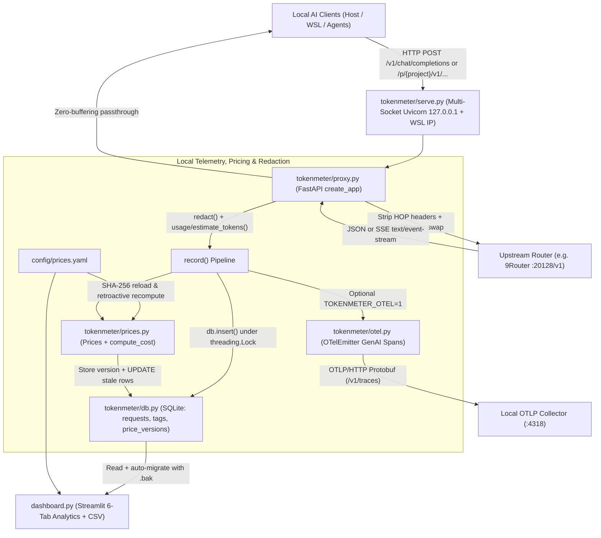

# Architecture — `tokenmeter`

`tokenmeter` is a local-first, privacy-preserving OpenAI-compatible HTTP logging proxy, pricing engine, OpenTelemetry GenAI span emitter, and Streamlit analytics dashboard. Positioned transparently between local AI coding/agent clients (Codex, Antigravity, custom RAG/agent apps, WSL workloads) and an upstream OpenAI-compatible router (defaulting to 9Router at `http://127.0.0.1:20128/v1`), it records token usage, latency splits (`ttft_ms`, `upstream_ms`, `overhead_ms`), project/key-value tags, and list-price-equivalent USD costs without ever persisting prompts, completions, or API keys.

---

## 1. System Context & Data Flow



---

## 2. Execution & Streaming Telemetry Pipeline

```mermaid
sequenceDiagram
    participant Client as "AI Client"
    participant Proxy as "tokenmeter/proxy.py::chat()"
    participant Up as "Upstream (/chat/completions)"
    participant Prices as "tokenmeter/prices.py::Prices"
    participant DB as "tokenmeter/db.py (SQLite)"
    participant OTel as "tokenmeter/otel.py::OTelEmitter"

    Client->>Proxy: POST /p/{project}/v1/chat/completions (headers + JSON body)
    Proxy->>Proxy: Extract tag, project, parse_tags(X-TokenMeter-Tags)
    alt Invalid JSON payload
        Proxy-->>Client: HTTP 400 {"error": {"message": "invalid JSON"}}
    end
    opt body.stream == true
        Proxy->>Proxy: Inject body.stream_options.include_usage = true
    end
    Proxy->>Proxy: fwd_headers() (strip HOP, swap TOKENMETER_REPLACE_AUTH / NINEROUTER_API_KEY)
    Proxy->>Up: Forward HTTP POST (standard or stream=True)
    alt Upstream network / transport failure (httpx.HTTPError)
        Proxy->>DB: record(status_code=502, redacted error, upstream_ms, overhead_ms)
        Proxy-->>Client: HTTP 502 {"error": {"message": "upstream error: ..."}}
    else Streaming 2xx SSE response
        loop Each raw chunk from r.aiter_raw()
            Up-->>Proxy: Raw SSE bytes
            Proxy->>Proxy: Accumulate upstream wait, scan() delta pieces (ttft_ms) & usage
            Proxy-->>Client: Yield raw chunk immediately
        end
        Proxy->>Proxy: finally: aclose(), scan("\\n"), fallback estimate_tokens() if usage missing
        Proxy->>Prices: cost(requested_model, prompt_tokens, completion_tokens)
        Prices->>Prices: reload() prices.yaml if SHA-256 changed; compute_cost()
        Proxy->>DB: insert(requests row + tags rows)
        opt TOKENMETER_OTEL enabled
            Proxy->>OTel: emit("chat {model}" span without prompts/keys)
        end
    else Non-streaming response (or >=400 upstream error)
        Up-->>Proxy: Full HTTP response bytes
        Proxy->>Proxy: parse_body() lenient JSON/SSE decode + redact(error)
        Proxy->>Prices: cost(requested_model, prompt_tokens, completion_tokens)
        Proxy->>DB: insert(requests row + tags rows)
        opt TOKENMETER_OTEL enabled
            Proxy->>OTel: emit("chat {model}" span)
        end
        Proxy-->>Client: Return upstream status, content-type, and raw bytes
    end
```

---

## 3. Detailed Module Breakdown

| File | Responsibility |
| :--- | :--- |
| `tokenmeter/__init__.py` | Package marker for the `tokenmeter` Python package. |
| `tokenmeter/proxy.py` | Core FastAPI proxy factory (`create_app`, `get_app`). Implements secret scrubbing (`redact`), structured header tag parsing (`parse_tags`), `~4 chars/token` fallback estimation (`estimate_tokens`), lenient JSON/SSE body extraction (`parse_body`), hop-by-hop header stripping and placeholder auth substitution (`fwd_headers`), `/healthz`, `/v1/models`, `/v1/chat/completions`, and `/p/{project}/v1/...` routes. |
| `tokenmeter/db.py` | SQLite persistence and schema migration layer (`connect`, `_migrate`, `insert`). Manages `requests`, `price_versions`, and `tags` tables, serializes writes via module-level `threading.Lock()`, and performs online `sqlite3.Connection.backup()` snapshots (`<db>.bak-YYYYmmdd-HHMMSS`) prior to `ALTER TABLE` M2 column migrations (`project`, `upstream_ms`, `overhead_ms`). |
| `tokenmeter/prices.py` | Deterministic list-price engine (`Prices`, `compute_cost`). Hashes `config/prices.yaml` with SHA-256, records immutable version history in `price_versions` (reusing version IDs on content revert), supports `long_context` input/output tier thresholds, keys strictly on the **requested** model ID (never guessing `0` for `null`/unknown models), and retroactively recomputes `requests.cost` when rates change. |
| `tokenmeter/otel.py` | Opt-in OpenTelemetry exporter (`OTelEmitter`, `from_env`) activated via `TOKENMETER_OTEL=1`. Exports OTLP/HTTP GenAI semantic convention spans (`gen_ai.operation.name="chat"`, `gen_ai.request.model`, token counts, latency metrics, tags, and redacted error status) via `BatchSpanProcessor`. |
| `tokenmeter/serve.py` | Multi-interface CLI launcher (`python -m tokenmeter.serve`). Binds discrete IPv4 sockets (`127.0.0.1` plus repeatable `--extra-host` IPs such as WSL's `vEthernet` adapter) and passes them to `uvicorn.Server.run(sockets=...)` so WSL can reach the proxy without exposing `0.0.0.0` on LAN/Wi-Fi. |
| `dashboard.py` | Six-tab Streamlit observability UI (`By model`, `By client tag`, `By project`, `Charts`, `Key/value tags`, `Price versions`) displaying call volume, error rate, token totals, list-price-equivalent USD, p50/p95 total/TTFT/overhead latencies, estimated-usage warnings, and CSV export. |
| `smoke.py` | Local integration smoke script exercising non-streaming, streaming, and dashboard startup against a live upstream. |
| `config/prices.yaml` | Sourced public list-price catalog (`per: 1000000` tokens, USD) with citation URLs and `long_context` tiers; unverified models default to `{input: null, output: null}`. |
| `scripts/start.ps1`, `stop.ps1`, `register-task.ps1` | Windows operational lifecycle scripts for background startup (auto-detecting WSL `vEthernet (WSL*)` IPv4), PID-file shutdown, and Task Scheduler logon registration. |

---

## 4. State Management, Persistence, Concurrency & Failure Handling

- **SQLite Schema & Safe Online Migration:** `tokenmeter/db.py` persists three relational tables: `requests` (telemetry, latency splits, token counts, `usage_source`, `cost`, `price_version`), `price_versions` (`yaml_sha UNIQUE` content ledger), and `tags` (`1:N` key/value pairs indexed by `request_id` and `(key, value)`). Opening a pre-M2 database automatically commits pending state, creates a consistent online backup via `c.backup(bk)`, and applies `ALTER TABLE requests ADD COLUMN` inside a transaction (`db.py:24-38`).
- **Concurrency Model:** FastAPI runs coroutines on a single-process `asyncio` event loop multiplexing concurrent upstream HTTP/SSE streams via a shared `httpx.AsyncClient`. SQLite connections are opened with `check_same_thread=False`, and all mutating SQL operations (`db.insert` and `Prices.reload`) synchronize on `dbm._lock` (`threading.Lock`).
- **Zero-Secret & Zero-Prompt Privacy Invariant:** Request prompts and assistant completions are never written to SQLite or OTel spans. Streaming text chunks are accumulated only transiently in request-local `st["text"]` to compute `estimate_tokens()` if the upstream omits a `usage` object, then discarded. Error payloads pass through `redact()` (`proxy.py:12-21`), which scrubs `NINEROUTER_API_KEY`, `OPENAI_API_KEY`, `Bearer <token>` headers, and `sk-...` tokens and truncates strings to `2,000` characters.
- **Resilient Failure Isolation:**
  - **Upstream Unreachable (`httpx.HTTPError`):** `/v1/models` returns HTTP `502`; `/v1/chat/completions` records a `status_code=502` telemetry row with redacted error context and returns HTTP `502` JSON (`proxy.py:128-131, 150-153`).
  - **Mid-Stream Disconnects / Malformed SSE:** The `StreamingResponse` generator (`gen()`, `proxy.py:184-203`) wraps `aiter_raw()` in `try ... except ... finally`, guaranteeing `await r.aclose()`, trailing buffer flush (`scan(b"\n")`), token estimation fallback (`usage_source="estimated"`), and telemetry recording even if the upstream resets mid-stream or the client disconnects.
  - **Telemetry Fault Tolerance:** Both `dbm.insert()` and `otel.emit()` inside `record()` (`proxy.py:91-95`) are isolated inside `try/except` blocks so database lock errors, corrupted `prices.yaml` edits (`Prices.cost` `lines 49-50`), or unreachable OTLP collectors never fail client LLM responses.

---

## 5. Running & Verifying Tests Locally

Run the complete `pytest` suite (including `httpx.ASGITransport` proxy tests, pricing recomputation, OTLP protobuf collector verification, Streamlit `AppTest` rendering, and audit boundary tests) using the repository virtual environment:

```powershell
Push-Location C:\Users\ardhy\Projects\tokenmeter
.\.venv\Scripts\python.exe -m pytest -q
Pop-Location
```
